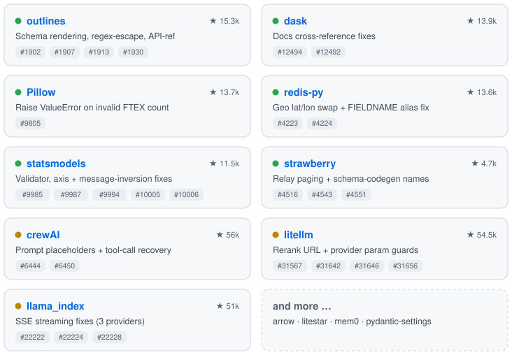

# Hi, I'm Ritika Shrestha 👋

 
  

📍 Granville, OH | 📧 shrest_r2@denison.edu  
---
## 💡 About Me
Hi, I am Ritika, and I just completed my bachelor's in computer science and math at Denison University. Last summer, I interned as a software engineer at **TransCore**, where I worked with my team to build an AI-powered customer service chatbot. I used large language models such as LLaMA, Mistral, and Qwen, combined with retrieval-augmented generation. I deployed the system on Google Cloud virtual machines to automate FAQ responses and toll processing inquiries.

Recently, as a **Cornell Tech fellow**, I also worked on a project with **Nestlé** to identify flavor trends among consumers and predict future market demands.

These experiences sparked my interest in building automation solutions that improve efficiency and enhance the user experience.

---

## 🛠 Skills

**Languages:**  
 
 
 
 
 
  

**Frameworks & Tools:**  
 
 

 
 
 
 
 
  

---

## 🌟 Open Source Contributions

> 20+ merged & open PRs and issues across open-source projects totaling **~300k ⭐**

<picture>
  <source media="(prefers-color-scheme: dark)" srcset="assets/contributions-dark.svg">
  
</picture>

🟢 merged &nbsp;·&nbsp; 🟡 in review &nbsp;·&nbsp; ⭐ repo stars

🐛 **Issues reported:** [huggingface_hub #4536](https://github.com/huggingface/huggingface_hub/issues/4536) · [outlines #1901](https://github.com/dottxt-ai/outlines/issues/1901) · [outlines #1912](https://github.com/dottxt-ai/outlines/issues/1912) · [pydantic-settings #911](https://github.com/pydantic/pydantic-settings/issues/911) · [mem0 #5998](https://github.com/mem0ai/mem0/issues/5998) · [crewAI #6449](https://github.com/crewAIInc/crewAI/issues/6449)  
🔗 [Browse all my open-source pull requests →](https://github.com/search?q=is%3Apr+author%3Aritsth&type=pullrequests)

---

<!---
ritsth/ritsth is a ✨ special ✨ repository because its `README.md` (this file) appears on your GitHub profile.
You can click the Preview link to take a look at your changes.
--->
